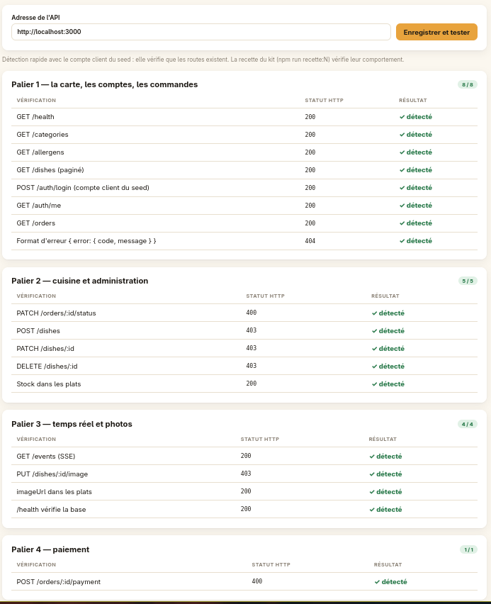
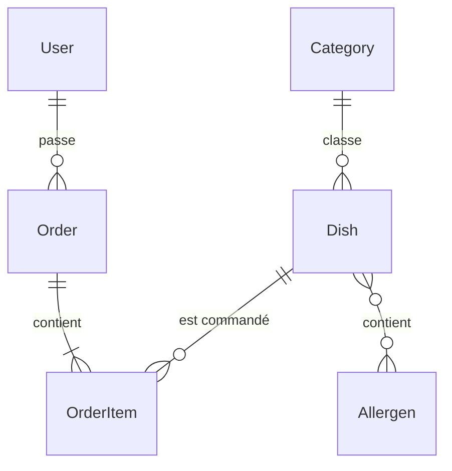

# La Roulotte : API de click & collect

API back-end d'un food truck : le client consulte la carte, commande en ligne, suit sa commande en direct et la paie ; la cuisine fait avancer les commandes ; l'administratrice gère la carte et le stock.
Projet de validation du cours de développement back-end (Node.js, TypeScript, Express 5, Prisma, SQLite).



*La page « Statut de l'API » du front fourni détecte les routes de chaque palier : 8/8, 5/5, 4/4 et 1/1.*

## Où on en est

| Moment | Palier atteint |
|---|---|
| Avant la soutenance orale | **Paliers 1 et 2** terminés |
| Après la soutenance orale | **Paliers 3 et 4** terminés |

La recette du kit (`npm run recette:4`, simulateur de paiement lancé) passe en entier : 71 tests sur 71. Le palier 4 compte aussi ses deux options : la documentation Swagger et le cache HTTP.

## Lancer le projet

Node.js 22 ou plus.

```bash
npm install
cp .env.example .env          # puis choisir un JWT_SECRET (16 caractères minimum)
npx prisma migrate deploy
npm run seed
npm run dev                   # http://localhost:3000
```

Autres commandes :

```bash
npm test                      # tests unitaires et HTTP, sans base ni API lancée
npm run typecheck
```

Avec le kit (dossier à part) : `npm run front` pour le front, `npm run paiement` pour le simulateur, `npm run recette:N` pour vérifier le palier N. Relancer `npm run seed` avant une recette, car elle crée des plats et des commandes.

Comptes du seed :

| Email | Mot de passe | Rôle |
|---|---|---|
| admin@roulotte.test | Admin123! | ADMIN |
| cuisine@roulotte.test | Cuisine123! | STAFF |
| client@roulotte.test | Client123! | CUSTOMER |

Documentation interactive : <http://localhost:3000/docs> (Swagger UI).

## Ce qui ne marche pas, ou pas complètement

- Le test à la main dans le front n'a pas été fait pour tous les écrans (la page « Statut » ne vérifie que l'existence des routes, pas leur comportement).
- Le garde-fou contre le double paiement (un double clic donne 409) ne vaut que pour une seule instance de l'API ; avec plusieurs instances, il faudrait un verrou en base.
- Si une commande est annulée entre l'appel au prestataire et l'enregistrement du paiement, le client est débité et l'API répond 409. Il n'y a pas de remboursement automatique.
- À l'arrêt de l'API, les connexions SSE ouvertes ne sont pas fermées proprement.

## Schéma de données



| Modèle | Champs principaux |
|---|---|
| User | email (unique), name, passwordHash, role (CUSTOMER, STAFF, ADMIN) |
| Category | name (unique), position |
| Allergen | code (unique), label |
| Dish | name (unique), description, priceCents, available, stock (null = illimité), imageUrl |
| Order | status, note, totalCents, paymentStatus (UNPAID, PAID), createdAt, updatedAt |
| OrderItem | quantity, unitPriceCents (prix figé à la commande), clé composite (orderId, dishId) |

Un plat déjà commandé ne peut pas être supprimé (`onDelete: Restrict`) : on le rend indisponible. Une migration par évolution du schéma (`prisma/migrations`).

## Architecture

Chaque domaine est un module `src/modules/<domaine>/` avec la chaîne **routes → controller → service → repository** :

- les **routes** décident qui a le droit d'appeler (`requireAuth`, `requireRole`) ;
- le **controller** valide l'entrée (schémas Zod stricts) et choisit la sortie (fonctions `toXxxDto`, jamais de `passwordHash`) ;
- le **service** porte les règles métier et ne connaît ni `req` ni `res` ;
- le **repository** est le seul à parler à Prisma, derrière une interface.

`src/container.ts` est la racine de composition : le seul endroit qui assemble les objets (repositories, services, bus d'événements, passerelle de paiement). Les tests utilisent des repositories en mémoire à la place de Prisma.

La configuration est lue et validée une seule fois (`src/config.ts`) : l'API refuse de démarrer sans `JWT_SECRET`. L'authentification (JWT, bcrypt, Helmet, CORS, anti force brute) vient du module fourni `src/fourni/auth`, branché sans modification.

## Les patterns, et le problème que chacun résout

| Pattern | Problème dans le projet | Où |
|---|---|---|
| Singleton | Un seul `PrismaClient`, sinon des connexions en trop | `src/shared/prisma.ts` |
| DAO / Repository | Le métier ne doit pas dépendre de Prisma, et doit se tester sans base | `src/modules/*/*.repository.ts` |
| DTO | Valider ce qui entre, ne montrer que ce qui sort | `*.dto.ts`, `src/shared/validation.ts` |
| Adapter | Brancher notre repository d'utilisateurs sur le module d'authentification fourni ; parler au prestataire de paiement sans que le métier connaisse son protocole | `src/modules/users/user.repository.ts`, `src/modules/payments/payment.gateway.ts` et `payment.http-gateway.ts` |
| Factory | Choisir la passerelle de paiement (HTTP ou factice) selon la configuration | `src/modules/payments/payment.factory.ts` |
| Decorator | Mettre la carte en cache sans toucher au repository Prisma | `src/modules/menu/cached-menu.repository.ts` |
| Observer | Le service des commandes annonce des événements sans savoir qui écoute (flux SSE, invalidation du cache) | `src/shared/event-bus.ts`, `src/modules/events/events.hub.ts` |
| Machine à états | Les transitions de statut sont décrites à un seul endroit | `src/modules/orders/order-status.ts` |
| Middlewares | Sécurité, journal des requêtes, 404, gestion d'erreurs unique au format du contrat | `src/app.ts`, `src/shared/errors.ts`, `src/shared/logger.ts` |

Les transactions Prisma protègent le stock : une commande est créée et le stock décrémenté en une seule transaction, avec un décrément conditionnel (jamais « lire puis écrire »). Une commande refusée ne consomme rien.

## Les paliers

1. **Service minimum** : carte (filtres, pagination, filtre par allergène), comptes, commandes avec prix calculés par le serveur, accès limité au propriétaire (404 sur la commande d'un autre).
2. **Coup de feu en cuisine** : cycle de vie des commandes, administration de la carte, stock avec remise en stock à l'annulation.
3. **En direct** : flux SSE (`GET /events`), photos des plats (2 Mo, type vérifié sur le contenu), cache de la carte, logs structurés avec `X-Request-Id`, `/health` qui interroge la base.
4. **Encaissement** : paiement via un prestataire externe (délai de 2 s, 3 tentatives avec attente croissante, même `Idempotency-Key`), plus les deux options ci-dessous.

### Options du palier 4

- **Documentation interactive** : Swagger UI sur `/docs`, générée à partir du contrat (`docs/openapi.yaml`, copie du contrat fourni). Montée dans `src/container.ts` par `src/modules/docs/docs.routes.ts`.
- **Cache HTTP** : Express calcule un ETag sur chaque réponse JSON et répond 304 si le client le renvoie (`If-None-Match`). Le middleware `src/shared/revalidate.ts` ajoute `Cache-Control: no-cache` sur les lectures de la carte, pour qu'une modification reste visible tout de suite.

## Tests

`npm test` lance les tests Vitest : des tests unitaires de services avec de faux repositories, et des tests HTTP avec Supertest sur `createApp(container)` avec des repositories en mémoire. Ils couvrent aussi les cas d'erreur (401, 403, 404, 409, 422), la machine à états, le stock, le cache, l'upload et l'adaptateur de paiement face à un faux prestataire.
